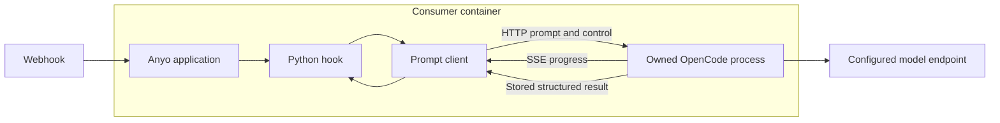

# Execute prompt files through OpenCode

## For Humans

A webhook pipeline needs to ask OpenCode to do work, observe its progress, and use the answer in ordinary Python code. This task delivers that connection with Python configuration and a predictable success or failure result, while the developer controls the prompt and its data format. Anyo and OpenCode run in one container, and the standalone client can later be reused by a worker.

Status: done  
Created: 2026-10-03  
Last updated: 2026-10-03  
Scope: code-based harness configuration, sync/async Python invocation, HTTP/SSE integration, structured results, progress events, process ownership, and Docker deployment.

## Objective and authorization

The initial request on 2026-10-03 authorized research and creation of this task. The user also required `anyo.harness(provider="opencode", plugins=[...], models=[{"model":"...", "key":"..."}])` and an actual Dockerfile. The subsequent instruction, “ok continue with the implementation,” authorized the library work recorded here.

Provide Python calls that read user prompt files, inject Anyo's result instructions, execute OpenCode, expose progress, and return typed results. Install the executable beside Anyo so Python starts it locally without Docker-in-Docker. The operator starts containers; Anyo starts and owns OpenCode processes inside them.

Dependencies: the existing [webhook lifecycle](../../knowledge/webhook-triggers.md) and [webhook task](../webhook-triggering-system/plan.md). Related knowledge: [product direction](../../knowledge/product-overview.md), [consumer API guide](../../knowledge/opencode-prompts.md), and [official-source research](research.md).

## Delivered design

The implementation chooses OpenCode 1.18.34 and direct Python HTTP/SSE through the optional `httpx2` extra. The HTTP server supports sessions, cancellation, and concurrent invocations with explicit lifecycle ownership; the CLI JSON event stream remains a researched alternative. No JavaScript bridge is required.

- `anyo.harness(...)` snapshots inert Python configuration. Each model has a provider-qualified identifier and API key; plugins preserve order. The adapter controls default/auxiliary model selection, provider credentials, permissions, and isolation from ambient OpenCode configuration.
- `anyo.inject_prompt(...)` works in synchronous hooks; `await anyo.ainject_prompt(...)` works in async hooks. `PromptClient` supports standalone `with`/`async with` ownership for future worker reuse.
- `PromptResult` exposes exactly one of `success` or `failure`, preserving any JSON `.data`. Failure includes `.code`, `.message`, and `.origin`; `raise_for_failure()` is an explicit bridge to webhook failure/redelivery tracking.
- The packaged system instruction and JSON schema require `type`, `data`, `failure_code`, and `failure_message`. Python validates the envelope independently. JSON data shape belongs to the user; no-JSON requests are instructed to return null. The model's semantic compliance cannot be guaranteed by schema validation.
- Optional progress callbacks expose status, visible text, tool lifecycle, and opt-in reasoning. Their bounded buffer reports dropped events. Progress and final result state remain separate; observer exceptions do not change the result.
- One lazy local server serves a client, with a fresh session and one submitted prompt per call. Anyo authenticates loopback requests, discovers the actual bound port, isolates temporary state, drains raw child output privately, and reaps its process group on shutdown.
- Async acceptance is followed by message/status reconciliation. SSE reconnects can lose progress and do not replay the prompt. Ambiguous submission is not retried. Timeout/cancellation abort and delete owned sessions, with bounded cleanup and runtime failures when output cannot be established.
- Borrowed-server mode validates compatibility without changing or stopping the server. The default owned mode supplies the topology requested for a future remote worker running Anyo in its own container.
- The root [Dockerfile](../../../Dockerfile) installs Python, Anyo's OpenCode extra, checksummed glibc binaries for ARM64/AMD64, Git, ripgrep, certificates, and `tini`; it runs as UID 10001. Only the consumer webhook port needs publication.

Two real-binary findings refine the researched proposal: Anyo must explicitly allow OpenCode's reserved `StructuredOutput` tool, and the pinned API needs a latest-message read to avoid an upstream encoding error for persisted user-message formats. Both are explained in [research](research.md#implementation-findings-from-the-real-binary) and covered by regressions. Upgrading the executable requires rerunning the real-binary smoke and revisiting these version-specific choices.

## Component ownership

| Component | Responsibility |
| --- | --- |
| `src/anyo/agents.py` | Harness/backend contracts, typed results, sync/async clients, callbacks, application context binding. |
| `src/anyo/prompts.py` and `_prompt_envelope.txt` | File/context loading, finite JSON boundary, installed output schema/instruction. |
| `src/anyo/integrations/opencode/` | Config translation, HTTP/SSE protocol, permissions, process and state ownership. |
| `src/anyo/application.py` | Per-application harness registration and lifespan integration. |
| `src/anyo/__init__.py` | Inert default composition and convenience exports. |
| `pyproject.toml`, `.dockerignore`, `Dockerfile` | Optional dependency, package resource, limited build context, bundled executable. |
| `examples/opencode_review.py`, `examples/review_pr.md` | Consumer hook, progress handling, and user-owned response shape. |
| `tests/test_agents.py`, `tests/integrations/opencode/` | Consumer contracts, local HTTP/SSE failures, real-container smoke, explicitly selected live test. |

No empty capability scaffolding was added. Existing hook providers remain behind their contracts; core lifecycle and agent contracts do not import a concrete harness provider.

## Completion criteria and evidence

- [x] Python-only harness configuration and inert registration; model validation/default selection, plugin loading/failure, no interactive login, and isolated runtime config.
- [x] Synchronous and asynchronous calls with context/workspace inputs and mutually exclusive success/failure results; malformed/missing output is never success.
- [x] Object, array, scalar, empty, false, zero, and null data retain their shape; finite JSON size/depth and branch consistency are checked.
- [x] Local HTTP/SSE tests cover async acceptance, reconnection, ambiguous submission without retry, concurrent session isolation, progress-before-result, observer failures, bounded buffering, timeout, repeated cancellation, auth/version/config errors, and unattended interaction.
- [x] Owned process startup failure and hung startup release resources. Real-binary smoke covers abrupt child exit, restart, plugin failure before model submission, and temporary state cleanup. Borrowed servers survive client shutdown.
- [x] ARM64 and AMD64 Docker images build and run simultaneously as UID 10001. Each installed package completes five simulated-model prompts, including concurrent sessions and recovery after a killed child. Two simultaneously owned runtimes also use distinct ports/state in the same container; progress and configured plugin/model are verified. AMD64 execution uses emulation on the ARM64 host.
- [x] An explicit live-provider test checks requested JSON and no-JSON/null behavior with per-invocation deadlines. It is excluded by default; it has not been executed against a paid provider.
- [x] Full suite, lint/types, source-to-wheel build, metadata/resource inspection, and clean installed-package verification passed as recorded below.
- [x] Consumer guide, runnable example, Docker build/run instructions, progress/cleanup limits, and deferred scope are documented.

## Verification record

Verified on 2026-10-03:

- `python -m pytest -q`: **420 passed, 1 live test deselected**.
- `ruff check .`, `ruff format --check .`, and strict `mypy`: passed; mypy checked 21 source modules.
- `python -m build` built the source distribution and then its wheel; `twine check` passed for both. Inspection confirmed the optional `opencode` dependency, `py.typed`, and installed `_prompt_envelope.txt` resource, with no tests/examples inside the wheel.
- A clean Python 3.12 environment outside the checkout imported the base wheel without `httpx2`, loaded the resource, registered inert configuration, and produced the expected missing-extra error only when entering an OpenCode client.
- After installing the OpenCode extra and pytest, `pip check` passed and `python -I -m pytest` ran the extracted source archive's tests against the installed wheel: **420 passed, 1 deselected**. No editable install or source-path override was used.
- `docker build --platform linux/arm64` and `--platform linux/amd64` passed. Both images ran the real-binary smoke concurrently with only the smoke script mounted, using the installed package. Each reported UID 10001, five successful sessions, live text/tool progress, plugin failure without a model call, crash recovery, and independent same-container runtimes. The test containers were removed on exit.

The Python base tag resolved to manifest digest `sha256:54c85f3c47607a77f32adec749d3c81d1348bf25833671f512b26a9b6d778cb3` during verification. The Dockerfile pins the OpenCode binary/version/checksums; Python/OS dependencies remain resolved by their existing constraints, so it does not claim a fully locked supply chain. Python 3.12 was exercised on macOS and Linux; later Python versions and native Windows managed processes were not tested (owned processes explicitly require POSIX). No distribution was published.

The real binary receives responses from a local simulated Anthropic endpoint in `container_smoke.py`. This verifies executable compatibility, configuration, plugins, session correlation, structured-field extraction, events, failure cleanup, and container isolation. It does not verify model quality, arbitrary third-party plugins, or paid-provider authentication. `test_live.py` is explicitly opt-in with `ANYO_LIVE_MODEL` and `ANYO_LIVE_API_KEY`; ordinary tests do not incur model calls.

## Deferred scope and limits

No new job queue, queue abstraction, Redis integration, remote worker, scheduling, durable job store, automatic retry, or cross-machine dispatch is included. The existing webhook runtime's bounded in-memory execution is unchanged. A later worker can use `PromptClient` around its hook execution and own OpenCode locally.

Automatic PR checkout, GitHub comment posting, CLI slash commands, a UI, and prompt optimization are also outside this task. The example requires a caller-prepared PR diff/workspace. Sessions separate conversation state, not filesystem access; the caller chooses separate workspaces/containers where needed. Tool permissions, callbacks, model data, and already-performed external effects have the limits documented in the [API guide](../../knowledge/opencode-prompts.md).

## Sources

- User conversation and follow-ups, 2026-10-03 (no share link supplied): prompt execution, JSON envelope, progress, code configuration, Dockerfile, implementation authorization, and exclusion of worker/queue work.
- [Official-source research and tagged implementation evidence](research.md).
- [Repository implementation](../../../src/anyo/integrations/opencode/__init__.py), local tests, and real-container smoke results recorded above.
